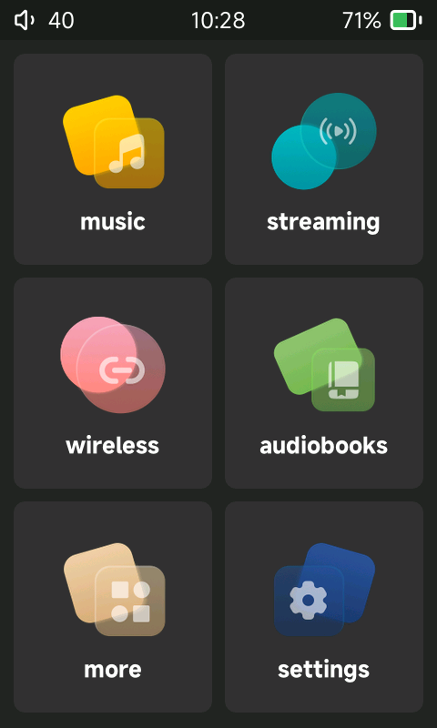

# UI review and visual evidence

## Provenance of the evidence

One genuine screenshot was captured in this session:

* Device profile: **HiBy R1 main screen** (the 480×800 frame actually captured).
* Environment: **host SDL simulator**, not a physical device.
* Binary: the prebuilt `sonix_player_host` found in the local working tree at
  `/home/diogo/Downloads/Hiby/sonix-player/sonix-player/sonix_player_host`
  (aarch64 ELF, built 2026-11-18). Its exact source commit is **not proven**.
* Command (abbreviated): bubblewrap mapping `/tmp/sonix-shot/sdcard` to
  `/mnt/sd_0`, `SDL_VIDEODRIVER=dummy SDL_AUDIODRIVER=dummy SONIX_PANEL=480x800
  SONIX_CONFIG=<temp config> ./sonix_player_host`, then `touch /tmp/sonix/shot`,
  which triggers the application's own screenshot path (`main.c:76-86`,
  `screenshot.c:19,99-128`) and writes a PNG from the SDL renderer
  (`main.c:1299-1319`).
* Result: `docs/QA/screenshots/r1/main.png`, 44,443 bytes, 480×800. The image was
  opened and inspected: it shows the main tile grid (music, streaming, wireless,
  audiobooks, more, settings) with status bar.

This is emulator/simulator evidence. It is **not** physical hardware validation
and **not** firmware screenshot evidence.

## Screenshot

**Figure 1.** HiBy R1 main screen, host SDL simulator, 480×800. Captured from the
project's own screenshot path using a prebuilt simulator binary; exact commit
unknown. Demonstrates the six-tile home screen and status bar. No claim is made
about device rendering.

## Limitations

* **R3 Pro II:** no screenshot produced. Attempts with `SONIX_PANEL=480x720`
  produced a 480×800 PNG, so the captured bitmap does not represent that panel.
  Those duplicate files were removed rather than mislabelled.
* **V1:** no screenshot produced. The prebuilt binary knows only the two HiBy
  profiles and clamps small panels to a 320×480 floor (`main.c:1113-1130`), so it
  cannot render the 240×320 V1 UI. The V1 fork has its own emulator and
  screenshot key, but no V1 image or emulator run was available here.
* **Before/after comparisons:** none. There is no reproducible previous build
  under the same conditions, so no comparison is claimed.
* The source-level layout constants (`padding=15`, `top_bar_height=44`) are the
  same for both HiBy devices; this was reported by the UI investigation but not
  visually re-verified on a second panel size.

## Assessment

The one captured image is an authentic rendering of the application and confirms
that the simulator screenshot path works. It is insufficient to support any
claim about R3 Pro II or V1 UI quality, readability, touch targets or
device-specific adaptation. Those require either a working per-device simulator
target or physical hardware.
