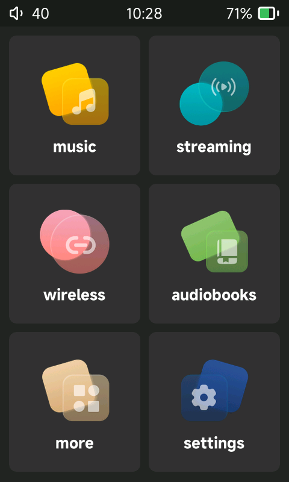

# Sonix Player — multi-device integration engineering report

**Reviewed implementation commit:** see `docs/reports/REVIEWED_COMMIT.txt` and the
final review message. The PDF and this Markdown source describe that commit.
**Branch:** `integration/three-device`. **Report date:** 2026-11-22.

> This report is deliberately candid. The requested task was a complete
> three-device firmware integration. What is delivered here is a verified
> investigation, an audit of all three sources, an independently reviewed
> firmware-safety assessment, a working structural validator, one genuine
> simulator screenshot, and a documented proposal. **No V1 code was merged, no
> per-device build targets or CI were implemented, no firmware was built, and no
> image is safe to flash.** Those gaps are stated throughout rather than hidden.

---

## 1. Executive summary

### What was achieved

* The complete local environment was inventoried and preserved: the primary
  repository had 11 unstaged modified files and 18 untracked entries; none was
  touched. Work was isolated in a new worktree/branch.
* Three sources were investigated: upstream `Tartarus6/sonix-player`
  (`5d8bb17`), the TempoTec V1 fork `mr-f0xx/sonix-player-tempotec-v1`
  (`e962720`), and the local fork at `7aa3637f7` (16 local commits ahead of
  `fork/main`).
* Competing implementations were compared neutrally; local improvements absent
  from the V1 fork were individually assessed.
* `tools/validate_upt.py` was implemented and executed. It independently parses
  the `.upt` ISO, verifies the OTA metadata, MD5 chains, per-chunk manifest and
  component MD5s, and reads device identity from the rootfs. Wrong-device,
  truncated and corrupted inputs were all rejected in real tests.
* Two independent reviews were performed. The firmware reviewer found a
  mandatory failure for R3 Pro II, changing its classification to **REJECTED**.
* One genuine R1 host-simulator screenshot was captured and inspected.

### What was not achieved

* V1 support is **not present** in the local tree and was **not merged**.
* There are no `make r1` / `make r3proii` / `make v1` targets.
* No firmware build was run; no image was generated by this work.
* No firmware-build CI was implemented.
* No full three-device screenshot set; no R3 Pro II or V1 screenshot exists.
* No before/after comparisons, no PDF-quality visual review of three panels.
* No physical device test; no flashing; no recovery test.
* No OTA code change (the dead `Jepl4r` remote remains in local assets).

### Readiness for submission

**Not ready for PR submission.** The work is an audit and safety package, not a
completed integration. It can be published as a proposal only if the owner
accepts that scope; it must not be presented as a finished three-device
firmware integration.

---

## 2. Scope and objectives

The task asked for one canonical codebase producing `r1.upt`, `r3proii.upt` and
`v1.upt`, with device-specific hardware/UI support, independent builds, reliable
packaging, CI/CD, safe OTA, documentation, tests, screenshots, a PDF report and a
prepared (not published) upstream PR. Investigation was explicitly required
before decisions, and firmware safety takes priority over delivery.

## 3. Repositories and local working tree investigated

| Source | Identity | Notes |
|---|---|---|
| Upstream | `Tartarus6/sonix-player` @ `5d8bb17` | Two HiBy models; no `.upt` tracked; official v1.3.1 release assets `r1.upt` 47,736,832 B and `r3proii.upt` 48,046,080 B |
| V1 fork | `mr-f0xx/sonix-player-tempotec-v1` @ `e962720` | Fork of Tartarus6, 966 commits ahead / 109 behind; V1-only board profile, packer and emulator; `v1.upt` releases with MD5 |
| Local | `/home/diogo/Downloads/Hiby/sonix-player` @ `7aa3637f7` | Branch `feat/stop-after-current-track`; remotes `CookieCaptainD` (live) and `Jepl4r` (404); 16 local commits; 11 modified + 18 untracked entries |

The workspace root itself is not a Git repository; it contains many repos and
worktrees. Evidence is in `docs/audit/LOCAL_WORKING_TREE.md`.

## 4. Feature inventory

Full table: `docs/audit/FEATURE_INVENTORY.md`. Highlights:

* Local/upstream: one binary, runtime `system-info.json` profile; two model asset
  trees; ISO/OTA packer; GitHub Releases OTA with conditional SHA-256 check.
* V1 fork: single-model compile-time `board_profile`, 240×320 compact UI,
  stock-preserving packer, V1 web emulator, themes/DLNA/lyrics/extra games.
* Local-only: stop-after-current-track, phone-identity car mode, A2DP keep-alive,
  AXP2101 charge work with tests, 48 MiB image gate, uncommitted browser-state
  and lock-screen-date work.
* No source signs firmware.

## 5. Neutral comparison of implementations

Full comparison: `docs/audit/IMPLEMENTATION_COMPARISON.md`. The seven compared
areas were device profile, firmware packaging, OTA selection/integrity, AXP
charging, browser state, car mode and validation tooling. Decisions: preserve
the HiBy runtime profile and V1 board profile separately; preserve both packers;
preserve OTA per device and document migration; keep AXP and car-mode code per
device (high regression risk); prefer V1's tested browser-state implementation;
add the new validator. Three investigation streams supplied independent
assessments; unresolved disagreements are recorded, not papered over.

## 6. Local improvements absent from the V1 fork

Full analysis: `docs/audit/LOCAL_V1_GAP_ANALYSIS.md`. Summary:

| Local improvement | Decision |
|---|---|
| Stop-after-current-track | Adopt local (self-contained, no hardware dependency) |
| Car mode as phone-identity switching | Hybrid, deferred — V1 has a different design |
| A2DP keep-alive API | Adopt local on HiBy only |
| Browser-state (uncommitted copy) | Replace with tested V1 design; compare committed `SNXBRW2` branch |
| AXP2101 charge stop/restore | Preserve both; provenance unresolved |
| `strace` removal / 48 MiB gate | Adopt build rule where size budget applies |
| HiBy `main.conf` assets | Exclude from V1 |
| Uncommitted lock-screen date / USB wake | Preserve, not integrated |

None of these was merged into V1 or upstream by this work.

## 7. Final architecture (proposed, not implemented)

Retain the single application binary with a runtime device table for R1/R3 Pro
II; retain the V1 fork's compile-time board profile for its 240×320 panel;
retain per-device asset trees and per-device packers; add thin per-device build
wrappers and a validation gate; keep OTA selection keyed by device stem. Do not
force a common abstraction across the two different UI/board patterns. See
`docs/DEVICE_COMPATIBILITY.md` and `docs/architecture/DECISIONS.md`.

## 8. Important decisions and alternatives

D1–D9 are in `docs/architecture/DECISIONS.md`. The most consequential: preserve
the original tree; treat hardware claims as source-reported; do not unify the
two packers or profiles; add an independent validator; classify no image as
VERIFIED FOR FLASHING; claim only genuine screenshot evidence; do not publish.

## 9. Device-specific implementation details

See `docs/DEVICE_COMPATIBILITY.md`. R1: 480×800, single CS43131, CST8xx touch,
AXP2101, `xImage-R1`. R3 Pro II: 480×720, dual CS43198, GT9xx, MP2731,
`xImage-R3PII`. V1: 240×320, dual CS43131, CST8xx, stock 1.3 kernel with SPI
NAND support. All values are source-reported, not hardware-verified.

---

## 10–13. Screenshots and visual evidence

Complete review: `docs/QA/UI_REVIEW.md`.

**Figure 1 (only genuine screenshot).** HiBy R1 main screen, host SDL simulator,
480×800, from a prebuilt `sonix_player_host` in the local tree via the
application's own `/tmp/sonix/shot` screenshot path. SHA-256
`f3a84dc045d31698b4fab5f038476f12c0ee5dab9dfc13f9e888afd3276d5b9d`, 44,443
bytes. Exact source commit of the binary is **not proven**.

R3 Pro II: no screenshot — the captured PNG stayed 480×800 under
`SONIX_PANEL=480x720`, so it was discarded rather than mislabelled. V1: no
screenshot — the prebuilt binary knows only the two HiBy profiles and clamps
small panels to 320×480. Before/after comparisons: none, because no reproducible
previous build exists. No image is physical-device evidence.

## 14. Firmware build results

No firmware was built in this work. The local tree already contained a generated
`r1.upt` (49,936,384 B, SHA-256 `ada3415bc9be47c7228a141906c631c458c97eb77d2c4bce1eba97bb4959b875`)
and a stock `r1_original.upt` (44,255,232 B, SHA-256
`0fec88bb3ad0baa55a703e4e2b1038560d4a526f0dd024d2ed037f1560ed09f9`). The
independent reviewer located a generated R3 Pro II image (48,025,600 B,
`3b4d2242…0c8`) and confirmed stock V1 1.3 split parts in the V1 fork. None of
these was produced by this integration.

## 15. Firmware package structure and validation

The `.upt` is an ISO 9660 image with `ota_config.in`,
`ota_v0/ota_update.in`, `ota_v0/ota_compatibility.in`, `ota_v0.ok`, an
`ota_md5_*` manifest and 512 KiB MD5-chained component chunks. `tools/validate_upt.py`
reassembles and verifies them independently of the build script. Machine-readable
reports are in `docs/QA/validation/`. The validator proves **internal
consistency only**; it checks neither authenticity, signature, kernel
architecture/model, rootfs-to-partition fit nor compatibility value.

## 16. Flashability matrix

Full matrix with per-cell evidence: `docs/firmware/FLASHABILITY_MATRIX.md`.

| Device | Classification | Decisive reason |
|---|---|---|
| HiBy R1 | NOT VERIFIED FOR FLASHING | structural checks pass, but no device test, no vendor reference, no signature clarity |
| HiBy R3 Pro II | **REJECTED** | mandatory compatibility metadata absent; independent review confirmed FAIL |
| TempoTec V1 | NOT VERIFIED FOR FLASHING | no Sonix V1 image exists; stock image lacks generated identity |

## 17. SHA-256 checksums of firmware images inspected

| Image | Bytes | SHA-256 | Origin |
|---|---|---|---|
| local generated `r1.upt` | 49,936,384 | `ada3415bc9be47c7228a141906c631c458c97eb77d2c4bce1eba97bb4959b875` | local working tree, unverified rebuild |
| `r1_original.upt` | 44,255,232 | `0fec88bb3ad0baa55a703e4e2b1038560d4a526f0dd024d2ed037f1560ed09f9` | claimed stock, no vendor checksum located |
| `r3proii_original.upt` | 37,996,544 | `6ef350aa4a513201b8376768ed8c7593cf16ae84ae3f458c8a5338adf0420dbf` | claimed stock, found in another local worktree |
| official upstream `r1.upt` v1.3.1 | 47,736,832 | `b78cb5a5…d7b` (GitHub API digest; asset not downloaded) | upstream release |
| official upstream `r3proii.upt` v1.3.1 | 48,046,080 | `afee07d4…5a3` (GitHub API digest; asset not downloaded) | upstream release |

Local generated images match neither official digest. Firmware images are not
included in the review branch.

## 18. Signature and device identity validation

No cryptographic signature scheme, key or verification step was found in either
packer, the OTA client, CI or the images. Integrity is MD5 chains plus GitHub
asset digests (the latter checked by the client only when published). Device
identity is `system-info.json` **added by the Sonix overlay**; stock images have
no such file. The validator reads this identity from the rootfs and rejects a
mismatch. Source indicates the recovery kernel performs no model or signature
check.

## 19. Cross-device rejection and corrupted-package tests

Executed with exact commands and reports in `docs/QA/TEST_REPORT.md`:

* r1 image as r3proii → REJECTED; as v1 → REJECTED.
* r1 image truncated to 40,000,000 bytes → REJECTED (`iso_readable`).
* r1 image with one byte zeroed at offset 3,000,000 → REJECTED (`rootfs_chain`).
* Stock R1 image → REJECTED for identity (expected: no overlay).
* Independent reviewer repeated these and also tested real R3 Pro II and stock
  V1 images.

## 20. Recovery and rollback assessment

Source-derived only: HiBy failsafe reported as Volume Up + Power; in-app update
writes `ota:kernel2` to `/dev/mtd5` via `bootmode.sh Recovery`; recovery is to
reflash vendor stock. V1 requires its stock 1.3 kernel and fork README insists on
keeping the stock package. USB recovery, failsafe reliability after a failed
update, and vendor tooling are unknown. See `docs/firmware/RECOVERY_GUIDES.md`.

## 21. CI/CD implementation and validation

No firmware CI was implemented. At HEAD, local/upstream workflows are only
issue/title checks; a firmware build workflow exists on an unmerged local branch;
the V1 fork has `build-tempotec-v1.yml` and a web-emulator Pages workflow. CI
workflows were read, not executed.

## 22. OTA compatibility and migration

`ota.c` selects `<stem>.upt` from the newest 20 releases of the repo in
`ota-repo`, checks size, and checks SHA-256 only when published. The local
`ota-repo` points at a dead repository. Repository/owner/asset-name/tag changes
break selection. Full analysis: `docs/MIGRATION.md`. No OTA flow was executed.

## 23. Test commands and detailed outcomes

Full table: `docs/QA/TEST_REPORT.md`. Categories: repository inspection (PASS),
host build (**FAIL** — missing system `opusfile`/`wavpack` dev packages),
simulator capture (R1 PASS, R3/V1 FAIL), package validation (6/6 behavioural
expectations met), physical hardware (NOT TESTED). No result in this report is
claimed without a command in that table.

## 24. Emulator and physical hardware validation status

Emulator: one R1 host-simulator screenshot. Physical: none. No image was
flashed; no device was connected.

## 25. Independent agent reviews

Three investigation agents (archaeology, firmware/safety, UI/build/CI/OTA), one
independent QA reviewer and one independent firmware safety reviewer.
Key QA findings resolved here: `docs/` was git-ignored (fixed by force-adding),
overstated OTA safety/digest claims (corrected), validator exit-status bug and
dead parameter (fixed), `__pycache__` (removed), missing PDF and PR body (added).
Key firmware finding accepted: R3 Pro II REJECTED for mandatory metadata FAIL.
Remaining unresolved: V1 integration, per-device builds/CI, physical validation.

## 26. Outstanding issues and limitations

Critical/high: no V1 code, no per-device builds, no firmware CI, no physical
validation, R3 Pro II REJECTED, no official release assets inspected locally.
Medium: host build environment gap, one screenshot only, validator cannot check
authenticity/kernel model/partition fit, OTA dead remote. Low: exact commit of
prebuilt simulator binary unknown; no `test_axpcharge` run.

## 27. Complete file change inventory (this branch)

Added: `docs/audit/{LOCAL_WORKING_TREE,FEATURE_INVENTORY,LOCAL_V1_GAP_ANALYSIS,IMPLEMENTATION_COMPARISON}.md`;
`docs/{DEVICE_COMPATIBILITY,BUILDING,MIGRATION}.md`;
`docs/architecture/DECISIONS.md`;
`docs/firmware/{FLASHABILITY_MATRIX,FLASHING_SAFETY,RECOVERY_GUIDES}.md`;
`docs/QA/{TEST_REPORT,UI_REVIEW}.md` and `docs/QA/screenshots/r1/main.png`;
`docs/QA/validation/*.json`; `tools/validate_upt.py`; this report and the PDF.
Modified: none of the existing committed source files. Deleted/renamed: none.
Preserved untouched: all 11 modified and 18 untracked entries in the original
working tree.

## 28. Git commits, branch and reviewed SHA

Branch `integration/three-device`, base `7aa3637f7`. Exact reviewed commit SHA:
see `docs/reports/REVIEWED_COMMIT.txt`. Complete diff is available locally with
`git diff <base>..<reviewed>`.

## 29. Proposed Pull Request

Not published. Draft: `docs/reports/PR_BODY.md`. Target `Tartarus6/sonix-player`,
source fork `CookieCaptainD/sonix-player`, branch `integration/three-device`.
**It must not be opened without explicit user approval, and it must be
described as an audit/safety proposal, not a completed integration.**

## 30. Licences, attribution and provenance

GPL-3.0 `LICENSE` is byte-identical in all three sources (MD5 `db95b6e4…`,
35,129 B). Vendored libraries retain their own licences. Code from upstream, V1
fork and local work is attributed by source and commit SHA in
`docs/audit/IMPLEMENTATION_COMPARISON.md`; no third-party code is attributed to
this work. No proprietary firmware blobs were added; the stock `.upt` files were
not redistributed in the review branch.

---

## Final approval gate — summary sections

**A. Executive summary.** Careful audit and safety package; not a completed
integration; not ready for a PR that claims completion. **B. Sources.** Tartarus6
upstream, mr-f0xx V1 fork, local CookieCaptainD/Jepl4r tree. **C. Local
improvements.** Eight items, individually decided in `LOCAL_V1_GAP_ANALYSIS.md`.
**D. Change inventory.** Documentation, validator, one screenshot, six validation
reports, this report and PDF; no source changes. **E. Decisions.** D1–D9; main
disagreements: AXP charging equivalence and car-mode sharing (both unresolved).
**F. Git evidence.** Branch/commit above; no operation on the user's branch.
**G. Visual evidence.** One genuine R1 simulator screenshot; none for R3/V1;
full collection in PDF is therefore not three-device complete. **H. Firmware
evidence.** No image built here; classifications NOT VERIFIED / REJECTED /
NOT VERIFIED; explicit "do not flash" list in `FLASHABILITY_MATRIX.md`.
**I. Testing.** Commands and results in `TEST_REPORT.md`; physical testing none.
**J. Independent review.** Both reviewers' findings incorporated; QA's
critical issue (ignored docs) fixed. **K. Report.** Markdown and PDF paths;
PDF generated from this source; screenshot count honestly reported. **L.
Proposed PR.** Draft in `docs/reports/PR_BODY.md`; not published. **M.
Limitations.** No V1 integration, no per-device builds/CI, no physical
validation, no official asset inspection, R3 Pro II REJECTED.

**No remote publication and no flashing was performed. Approval is required
before either.**
